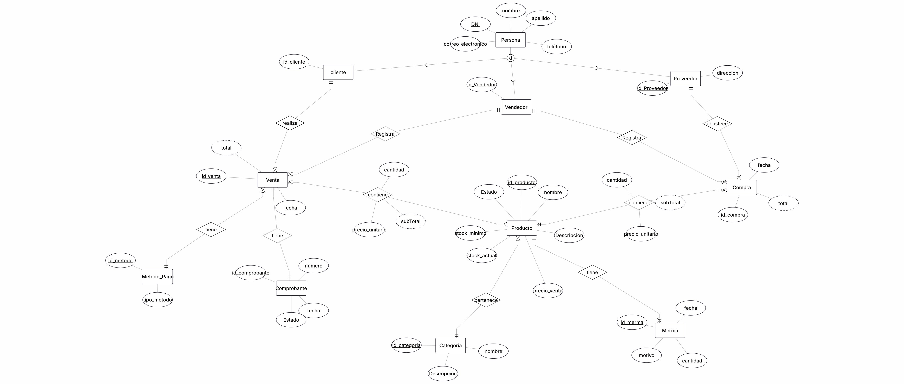

# 🌿 Verde Encanto
### Sistema de gestión de ventas, stock y abastecimiento para un vivero y tienda de jardinería

**Proyecto de Base de Datos I · Equipo 15**

---

## Tabla de contenidos

- [Descripción](#descripción)
- [Objetivo](#objetivo)
- [Alcance](#alcance)
- [Documentación del proyecto](#documentación-del-proyecto)
- [Modelos](#modelos)
- [Código SQL](#código-sql)
- [Integrantes](#integrantes)
- [Tecnologías y herramientas](#tecnologías-y-herramientas)

---

## 🌱 Descripción del proyecto

Este proyecto consiste en el **diseño, normalización e implementación** de una base de datos para un sistema de gestión comercial de un vivero y tienda de jardinería.

El sistema permite administrar la información relacionada con productos, clientes, proveedores y las operaciones comerciales de compra y venta, incluyendo el control del stock y los métodos de pago.

## 🎯 Objetivos

Diseñar una base de datos que permita gestionar de manera organizada y consistente la información de las operaciones comerciales del vivero.

Se busca garantizar la **integridad de los datos** y facilitar la gestión de clientes, proveedores, productos, compras, ventas y stock.

## Alcance

El sistema contempla, entre otras, las siguientes funcionalidades:

- Registro y gestión de clientes.
- Registro y gestión de proveedores.
- Gestión de productos y categorías.
- Registro de compras.
- Registro de ventas.
- Gestión de métodos de pago.
- Control y actualización del stock.
- Registro de los detalles de las operaciones.
- Generación y conservación de comprobantes.

## 📚 Etapas del proyecto

| Etapa | Descripción | Documento |
|:-----:|-------------|-----------|
| 1 | Alcance y funcionalidades | [Documentación de la Etapa 1](docs/etapa-01/alcance-funcionalidaddes.md) |
| 2 | Modelo conceptual | [Modelo conceptual](docs/etapa-02/modelo-conceptual.md) |
| 3 | Implementación SQL | [Documentación de la Etapa 3](docs/etapa-03/ddl.sql.md) |
| 4 | Consultas SQL y reportes | [Documentación de la Etapa 4](docs/etapa-04/ReporteAgregado.md) |

## Modelos

### Modelo conceptual

## Código SQL

| Tipo | Descripción | Archivo |
|:----:|-------------|---------|
| DDL | Creación de la estructura de la base de datos | [script.sql](SQL/ddl/script.sql) |

## 👥 Integrantes

- Craballo Jara Luciana Abril
- Encinas Priscila Ayelen
- Gonzalez Avril Araceli
- Fernández Zalazar Jeremías Ezequiel
- Belen Chaile

---

🌿 *Proyecto académico · Base de Datos I · Equipo 15*

