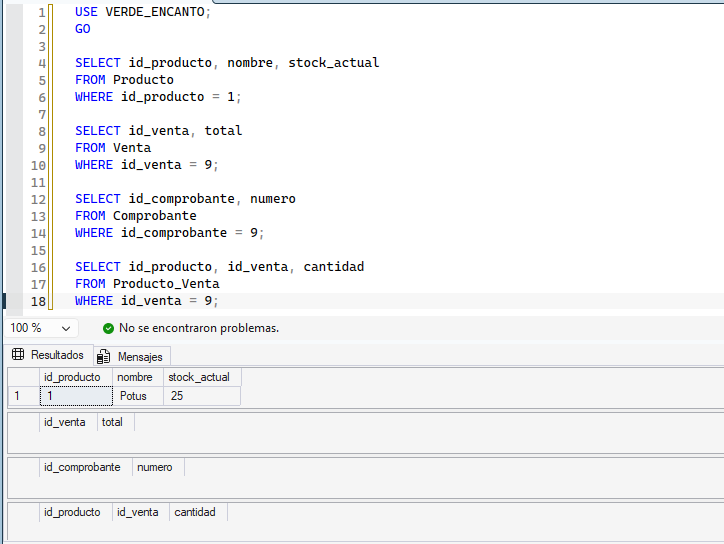
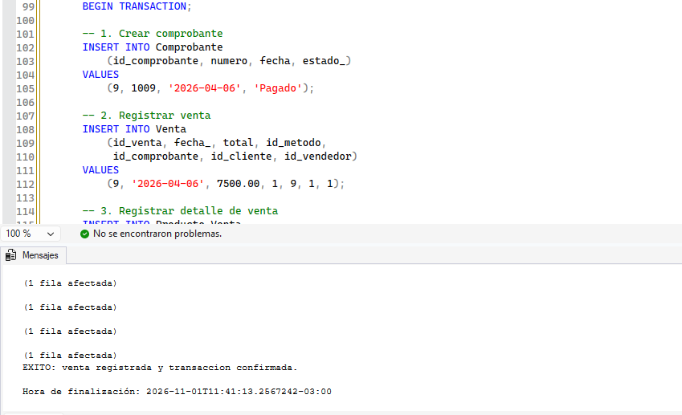
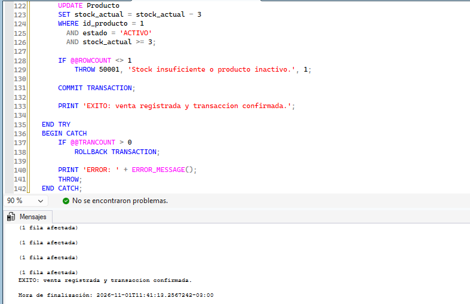
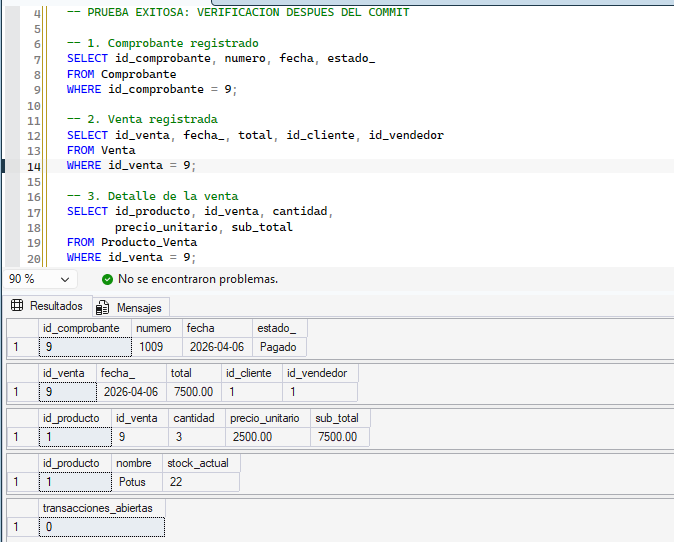
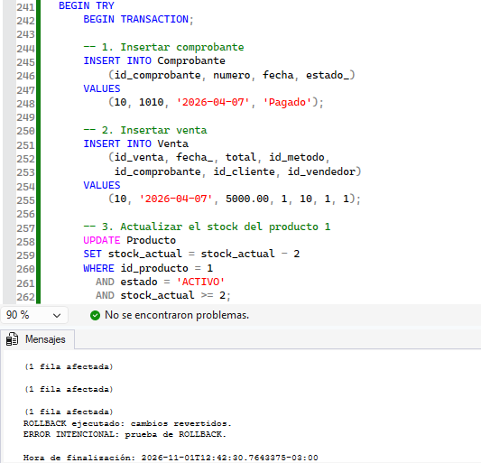
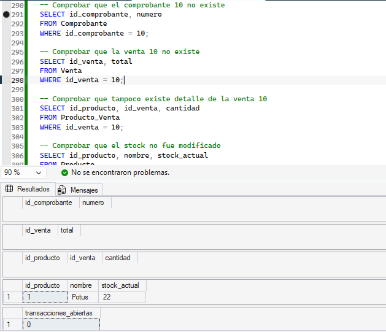
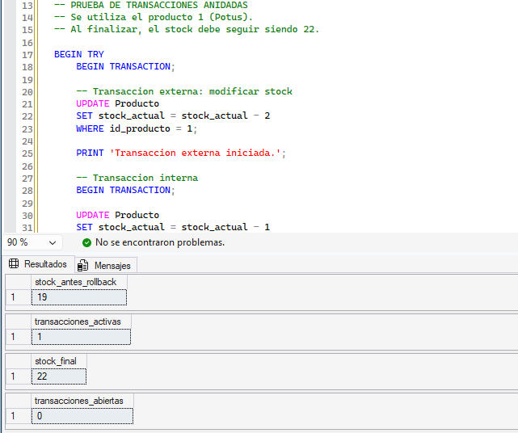
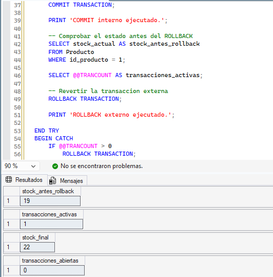

# Manejo de transacciones y transacciones anidadas

## 1. Introducción

En esta etapa del proyecto **VERDE_ENCANTO**, se implementaron y probaron transacciones en SQL Server para asegurar que las operaciones relacionadas con una venta se realicen de manera conjunta y mantengan la consistencia de la base de datos.

Registrar una venta involucra varias tablas: `Comprobante`, `Venta` y `Producto_Venta`, además de la actualización del stock en `Producto`. Si alguna operación falla, no deberían conservarse cambios parciales. Para comprobarlo, se utilizaron `BEGIN TRANSACTION`, `COMMIT`, `ROLLBACK` y el manejo de errores mediante `TRY...CATCH` y `THROW`.

También se realizó una prueba de transacciones anidadas para observar qué ocurre cuando se ejecuta un `COMMIT` interno y posteriormente un `ROLLBACK` externo.

El código utilizado se encuentra en [`Transacciones.sql`](../../sql/tecnico/Transacciones/Transacciones.sql).

## 2. Manejo de transacciones

Una transacción agrupa varias instrucciones SQL dentro de una misma unidad de trabajo. En las pruebas se utilizaron los siguientes recursos:

- **`BEGIN TRANSACTION`**: inicia una transacción.
- **`COMMIT TRANSACTION`**: confirma los cambios realizados durante la transacción.
- **`ROLLBACK TRANSACTION`**: revierte los cambios de una transacción que todavía no fue confirmada.
- **`TRY...CATCH`**: permite controlar errores y ejecutar el `ROLLBACK` cuando corresponde.
- **`THROW`**: genera un error; en las pruebas se utilizó para simular una falla.
- **`SET XACT_ABORT ON`**: configura la sesión para que determinados errores de ejecución provoquen la finalización y reversión de la transacción.
- **`@@TRANCOUNT`**: informa cuántos niveles de transacción permanecen abiertos en la sesión.

El objetivo principal fue comprobar la **atomicidad**: las operaciones que forman parte de una transacción deben confirmarse juntas o revertirse juntas.

## 3. Implementación de una venta mediante una transacción

Se trabajó con el producto **Potus** (`id_producto = 1`). Antes de registrar la venta, su stock era de **25 unidades**. También se verificó que no existieran la venta 9, el comprobante 9 ni un detalle asociado a esa venta.

La operación de venta incluyó cuatro pasos:

1. Insertar el comprobante 9 en `Comprobante`.
2. Insertar la venta 9, por **$7.500**, en `Venta`.
3. Insertar el detalle en `Producto_Venta`, con **3 unidades** del producto 1, a **$2.500** cada una.
4. Descontar esas 3 unidades del stock en `Producto`.

La actualización del stock incluyó una condición para evitar descontar unidades cuando el producto estuviera inactivo o no hubiera stock suficiente. Si la actualización no afectaba exactamente una fila, el código generaba un error mediante `THROW`.

### 3.1. Prueba 1: ensayo con ROLLBACK voluntario

Primero se realizó un ensayo de la operación completa. Se ejecutaron las inserciones y la actualización del stock dentro de una transacción y, antes de confirmar los cambios, se utilizó `ROLLBACK TRANSACTION` voluntariamente.

Este ensayo permitió comprobar el comportamiento de las instrucciones sin dejar registrada la venta de prueba. Luego se continuó con la operación definitiva.

### 3.2. Prueba 2: transacción exitosa con COMMIT

Se ejecutó nuevamente la operación completa y, al finalizar correctamente las inserciones y la actualización, se utilizó `COMMIT TRANSACTION` para confirmar los cambios.

Las siguientes capturas muestran el desarrollo de la transacción y su confirmación:

Después del `COMMIT`, se consultaron las tablas involucradas. Se comprobó que el comprobante y la venta 9 estaban registrados, que existía el detalle de 3 unidades y que el stock del Potus había disminuido de **25 a 22 unidades**. La consulta a `@@TRANCOUNT` devolvió **0**, lo que indicó que no quedaban transacciones abiertas en esa sesión.

**Resultado:** la operación se completó y los cambios quedaron guardados de manera conjunta.

## 4. Prueba 3: error intencional y ROLLBACK

Para verificar la reversión de cambios ante un error, se preparó una segunda operación de prueba con la venta 10 y el comprobante 10.

Dentro de una misma transacción se realizaron estas operaciones:

1. Insertar el comprobante 10 en `Comprobante`.
2. Insertar la venta 10 en `Venta`.
3. Descontar temporalmente **2 unidades** del stock del producto 1 mediante `UPDATE`.
4. Generar un error intencional con `THROW`, antes de llegar al `COMMIT`.

El bloque `CATCH` ejecutó `ROLLBACK TRANSACTION`, con el propósito de revertir tanto las inserciones como la actualización del stock.

### 4.1. Verificación después del ROLLBACK

Luego del error se consultaron nuevamente los datos. Los resultados fueron:

- No existía el comprobante 10.
- No existía la venta 10.
- No existían detalles asociados a la venta 10; en esta prueba no se había intentado insertar un detalle.
- El stock del Potus seguía siendo de **22 unidades**, por lo que el descuento temporal de 2 unidades no quedó guardado.
- `@@TRANCOUNT` devolvió **0**.

**Resultado:** las dos inserciones y la actualización realizadas antes del error fueron revertidas. Esta prueba demostró que no quedaron cambios parciales de la operación fallida.

## 5. Prueba 4: transacciones anidadas

Se realizó una prueba para observar el comportamiento de dos niveles de transacción sobre el stock del producto 1.

Primero se inició una transacción externa y se descontaron **2 unidades**. Luego se inició una transacción interna y se descontó **1 unidad adicional**. Partiendo de un stock de 22 unidades, el valor temporal pasó a **19**.

A continuación, se ejecutó `COMMIT TRANSACTION` para la transacción interna. En SQL Server, ese `COMMIT` disminuye el contador de transacciones, pero **no confirma definitivamente los cambios mientras la transacción externa siga abierta**. Por eso, `@@TRANCOUNT` mostró **1** después del `COMMIT` interno.

Finalmente, se ejecutó `ROLLBACK TRANSACTION` sobre la transacción externa. Se verificó que el stock volvió a **22 unidades** y que `@@TRANCOUNT` quedó en **0**.

**Resultado:** el `COMMIT` interno no impidió que el `ROLLBACK` externo revirtiera todas las modificaciones realizadas en ambos niveles.

## 6. Resumen de los resultados

| Prueba | Operación realizada | Resultado comprobado |
| --- | --- | --- |
| 1. Ensayo | Registro de venta con `ROLLBACK` voluntario | Los cambios del ensayo no se conservaron. |
| 2. Transacción exitosa | Inserciones y actualización de stock con `COMMIT` | Venta 9 registrada por $7.500; stock de 25 a 22. |
| 3. Error intencional | Dos `INSERT`, un `UPDATE` y `THROW` | No quedaron registros 10; stock conservado en 22. |
| 4. Transacciones anidadas | `COMMIT` interno y `ROLLBACK` externo | Stock temporal de 19 restaurado a 22. |

En las verificaciones finales se obtuvo `@@TRANCOUNT = 0`, indicando que no quedaron transacciones abiertas en la sesión utilizada para las pruebas.

## 7. Conclusión general

La implementación de transacciones en **VERDE_ENCANTO** permitió registrar una venta de forma conjunta en las tablas `Comprobante`, `Venta` y `Producto_Venta`, manteniendo actualizado el stock de `Producto`.

La prueba exitosa confirmó que, al ejecutarse `COMMIT`, todos los cambios de la operación quedan registrados. Por su parte, la prueba con error intencional demostró que `ROLLBACK` revierte tanto los registros insertados como la modificación del stock, evitando conservar una operación incompleta.

La prueba de transacciones anidadas permitió comprobar que un `COMMIT` interno no confirma definitivamente los cambios si todavía existe una transacción externa abierta. Al ejecutar el `ROLLBACK` externo, se revirtieron las modificaciones de ambos niveles.

En conclusión, el uso de transacciones y manejo de errores contribuye a preservar la **atomicidad y consistencia** de las operaciones de venta y control de inventario del vivero.

**Nota de ejecución:** las pruebas 1 y 2 utilizan identificadores fijos (venta 9 y comprobante 9) y se prepararon para un estado inicial en el que esos registros no existían. No deben ejecutarse nuevamente sobre una base que ya contiene la venta confirmada; las pruebas restantes deben ejecutarse por bloques, según las instrucciones del script.
