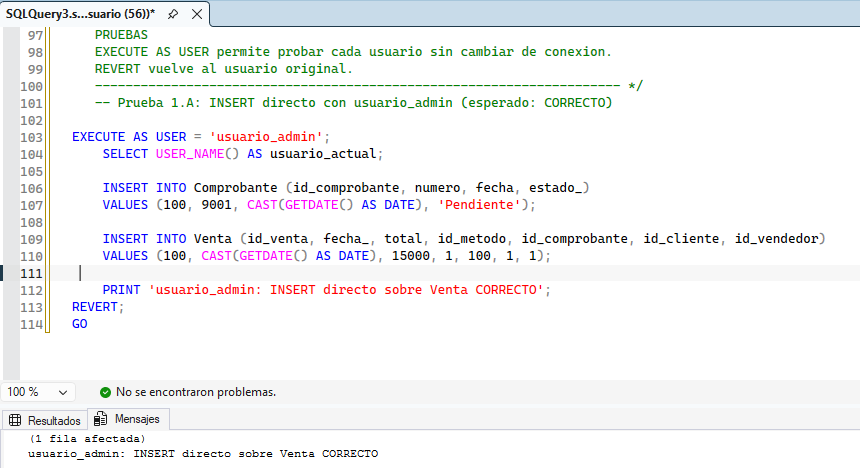
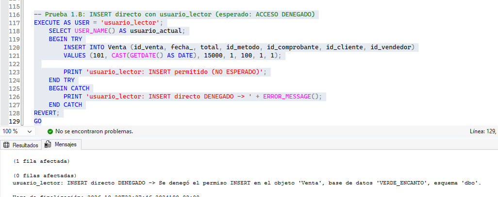
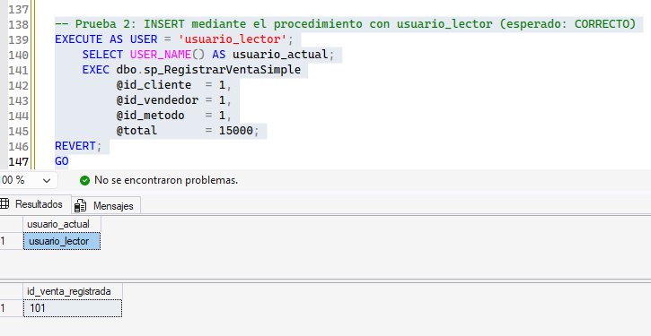
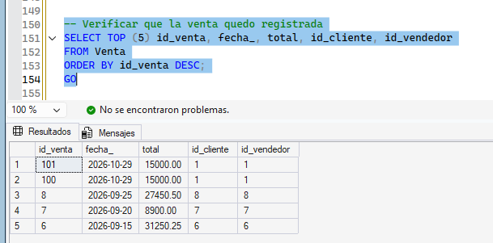
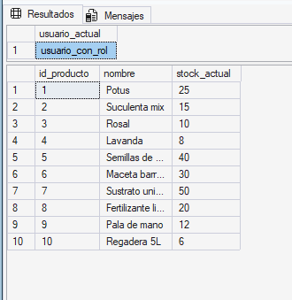
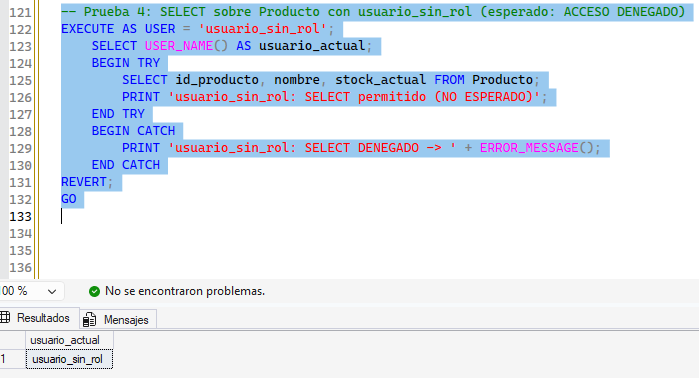

# Seguridad_Permisos

## Definición y funcionamiento

La seguridad en una base de datos permite controlar qué usuarios pueden acceder a la información y qué operaciones pueden realizar sobre ella. SQL Server permite administrar los permisos de manera individual (usuarios) o agrupándolos mediante roles, lo que facilita aplicar el principio de mínimo privilegio: cada usuario recibe únicamente los permisos que necesita para cumplir su función.

El objetivo de esta etapa es demostrar cómo se controla el acceso a la base VERDE_ENCANTO mediante permisos asignados a usuarios, permisos asignados a roles y permisos delegados a través de un procedimiento almacenado.

## Elementos de la seguridad en SQL Server

Login (inicio de sesión): credencial a nivel de servidor que permite conectarse a la instancia.

Usuario: identidad dentro de una base de datos, asociada a un login. Sobre el usuario se otorgan o niegan permisos.

Rol: conjunto de permisos con nombre al que se pueden agregar varios usuarios. Puede ser un rol fijo del motor (por ejemplo db_owner) o uno personalizado.

Los permisos se administran con tres sentencias: GRANT (otorgar), DENY (denegar explícitamente) y REVOKE (quitar un permiso otorgado o denegado).

## Aplicaciones prácticas

Los permisos y roles se utilizan para:

* Proteger la información sensible del sistema (datos personales, montos de ventas y compras).

* Evitar modificaciones accidentales o no autorizadas sobre las tablas.

* Asignar responsabilidades según el perfil de cada usuario (administrador, vendedor, personal de consulta).

* Permitir que un usuario realice una operación autorizada sin darle acceso directo a la tabla, usando procedimientos almacenados.

## VENTAJAS

* Protegen la información sensible del sistema.
* Evitan modificaciones accidentales o no autorizadas.
* Permiten asignar permisos según el perfil del usuario.
* Los roles simplifican la administración de accesos: el permiso se define una sola vez y se aplica a todos los miembros.
* Combinados con procedimientos almacenados, mantienen la lógica de negocio en un único lugar.
* Mejoran la seguridad y la mantenibilidad de la base de datos.

## Utilización en la etapa 5

Para esta etapa se trabajó con el siguiente esquema de usuarios y permisos, que representa perfiles reales del vivero:

| Perfil en el vivero | Usuario | Permisos |
|---|---|---|
| Dueño / administrador | usuario_admin | Control total de la base (rol db_owner) |
| Vendedor de mostrador | usuario_lector | Solo consulta la tabla Venta. Registra ventas únicamente mediante el procedimiento sp_RegistrarVentaSimple |
| Personal de consulta de stock | usuario_con_rol | Consulta la tabla Producto por pertenecer al rol rol_consulta_productos |
| Personal sin autorización sobre productos | usuario_sin_rol | Sin permisos sobre Producto |

Para crear logins propios de SQL Server, la instancia debe tener habilitada la autenticación mixta ("SQL Server and Windows Authentication mode") y reiniciarse el servicio. Las contraseñas del script son credenciales de prueba, usadas solo para la demostración.

### Permisos a nivel de usuarios

```sql
ALTER ROLE db_owner ADD MEMBER usuario_admin;

GRANT SELECT ON dbo.Venta TO usuario_lector;

GRANT EXECUTE ON dbo.sp_RegistrarVentaSimple TO usuario_lector;
```

El procedimiento sp_RegistrarVentaSimple registra una venta junto con su comprobante en una sola transacción. Aunque usuario_lector no puede insertar en la tabla Venta, sí puede ejecutar el procedimiento: como el procedimiento y las tablas pertenecen al mismo propietario (dbo), SQL Server aplica el encadenamiento de propiedad y solo verifica el permiso EXECUTE, sin volver a verificar los permisos sobre las tablas que el procedimiento utiliza.

### Permisos a nivel de roles

```sql
CREATE ROLE rol_consulta_productos;

GRANT SELECT ON dbo.Producto TO rol_consulta_productos;

ALTER ROLE rol_consulta_productos ADD MEMBER usuario_con_rol;
```

El permiso se asigna al rol y no a cada usuario, por lo que solo usuario_con_rol puede consultar Producto.

El script completo (logins, usuarios, procedimiento, roles, permisos y pruebas) se encuentra en [Seguridad_Permisos.sql](Seguridad_Permisos.sql).

## Pruebas de funcionamiento

Las pruebas se hicieron con EXECUTE AS USER, que permite asumir la identidad de cada usuario desde una misma ventana de consulta (REVERT vuelve al usuario original). Los casos que deben fallar se ejecutaron dentro de un bloque TRY...CATCH para mostrar el mensaje de error del motor.

### Prueba 1: INSERT directo sobre Venta

Con usuario_admin la operación se ejecuta correctamente, ya que pertenece a db_owner.



Con usuario_lector SQL Server rechaza la operación con el error 229: "The INSERT permission was denied on the object 'Venta', database 'VERDE_ENCANTO', schema 'dbo'."



### Prueba 2: INSERT mediante el procedimiento almacenado

Con usuario_lector, la venta se registra correctamente a través de sp_RegistrarVentaSimple, porque tiene permiso EXECUTE sobre el procedimiento.





### Prueba 3: SELECT sobre Producto

Con usuario_con_rol la consulta devuelve los productos, porque el usuario es miembro del rol rol_consulta_productos.



Con usuario_sin_rol SQL Server deniega el acceso con el error 229: "The SELECT permission was denied on the object 'Producto', database 'VERDE_ENCANTO', schema 'dbo'."



### Resumen de resultados

| Prueba | Usuario | Resultado esperado | Resultado obtenido |
|---|---|---|---|
| SELECT sobre Producto | usuario_con_rol | Correcto | Correcto |
| SELECT sobre Producto | usuario_sin_rol | Acceso denegado | Acceso denegado |
| INSERT directo sobre Venta | usuario_admin | Correcto | Correcto |
| INSERT directo sobre Venta | usuario_lector | Acceso denegado | Acceso denegado |
| EXEC del procedimiento | usuario_lector | Correcto | Correcto |

## CONCLUSION

Los permisos y roles en SQL Server son muy útiles cuando necesitamos controlar con precisión qué puede hacer cada usuario sobre la base de datos. Con los permisos por usuario se ajusta lo que cada persona puede hacer, con los roles se centraliza la administración de los accesos, y con los procedimientos almacenados se puede autorizar una operación puntual, como registrar una venta, sin dar acceso directo a las tablas. De esta forma se aplica el principio de mínimo privilegio y se reduce el riesgo de errores y de modificaciones no autorizadas en el sistema del vivero.
